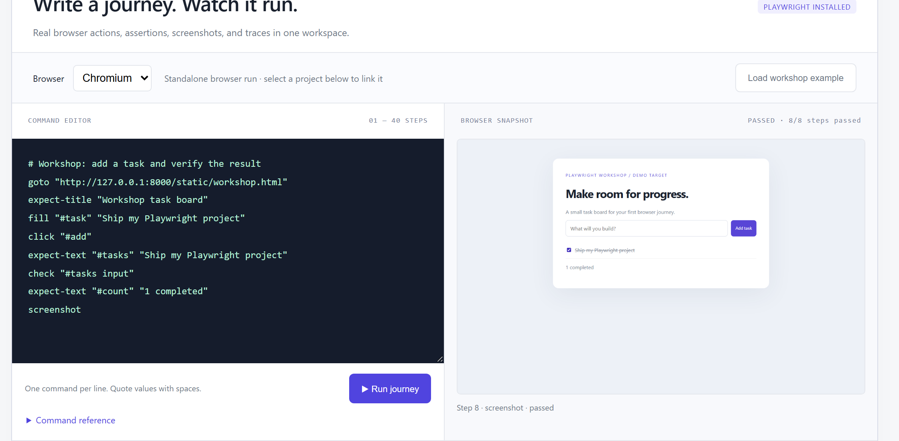
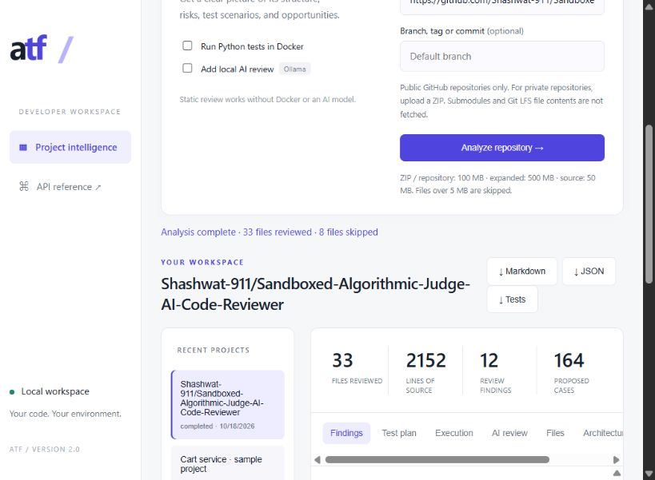

# Sandboxed Algorithmic Judge & AI Code Reviewer

A local code-review and browser-testing workbench. Import a project, inspect findings, run tests, and export the evidence.

**Stack:** Python · FastAPI · Playwright · SQLite · Docker · Ollama (optional)

## Preview

**Playwright Studio — browser journeys, screenshots, and downloadable traces.**



<details>
<summary>Repository review screenshot</summary>



</details>

## Engineering highlights

- **Code review:** ZIP/GitHub intake, source inventory, Python AST checks, security findings, and proposed test cases.
- **Browser testing:** guided commands or Python/JavaScript/TypeScript Playwright tests with step screenshots, console/network logs, and traces.
- **Docker test runner:** Python unittest execution with a non-root user, read-only filesystem, resource limits, and no network.
- **Optional AI review:** local Ollama feedback alongside static analysis; export reports as PDF, Markdown, or JSON.

`Project → static analysis + optional test execution → findings, test plan, and reports`

Docker isolation applies to the Python test runner; browser workers run as local subprocesses.

## Run locally

From the repository root, create and activate a Python virtual environment, then:

```bash
pip install -r requirements-demo.txt
python -m playwright install chromium
python -m uvicorn main:app --host 127.0.0.1 --port 8010
```

Open the [dashboard](http://127.0.0.1:8010) and choose **Try sample project**, or load the workshop example in Playwright Studio. [API docs](http://127.0.0.1:8010/docs) list the available endpoints.

Optional: install Docker for isolated Python tests; run `ollama pull qwen2.5:3b` for local AI review.

[Architecture](docs/ARCHITECTURE.md) · [Playwright guide](docs/PLAYWRIGHT_STUDIO.md) · [Verification](docs/VERIFICATION.md)
