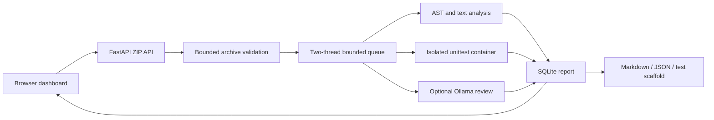

# Architecture and design review

## Current ATF path

The local demo deliberately removes mandatory PostgreSQL/Redis/model startup from the primary flow. Static analysis remains usable when either integration is offline. Each report separately records static validation, proposed cases, actual execution, and model output. Jobs use UUID identifiers and parameterized SQL. Browser rendering escapes uploaded names, findings and model text.

## Original architecture assessment

The original code was a single-submission judge, with no frontend, project ingestion, test oracle, project analysis or automated tests. It could measure a program's exit state but could not establish solution correctness against expected results. Its README overclaimed throughput and security without supporting tests.

Implementation defects found and corrected:

1. Container logs were requested after force removal, causing successful executions to fail during result collection.
2. Temporary directories used mode 0700 while the process ran as nobody, preventing workspace access.
3. C++ compilation used gcc instead of g++, omitting normal C++ library linkage.
4. PostgreSQL UUID columns expected UUID objects while callers passed strings.
5. ORM attributes were read after a committing session had expired and detached the object.
6. Docker client construction happened before the worker exception handler, leaving jobs unfinished when Docker was unavailable.
7. Queue dispatch failure left PENDING records; failures now mark ERROR and return 503.
8. AI timeout exceeded the worker soft limit; the worker window now accommodates it.
9. Error states could be overwritten with FAILED; infrastructure errors are now preserved.

## Boundaries

Source files are parsed as data on the host. Runtime code only runs inside Docker. The new runner streams validated JSON over container stdin into bounded tmpfs, avoiding host bind mounts and Windows/Linux path translation. It runs as UID 65534, drops all capabilities, disables network, uses a read-only root, and removes the container in a finally block. Test results are produced by untrusted project code and can be forged by a malicious submission; this is a developer tool, not an adversarial scoring service.

Static rules have false positives and false negatives. Import and manifest inventories do not resolve dependency graphs or validate versions. The generated scaffold contains skipped tests rather than invented assertions. Local AI has bounded context and can hallucinate. Review reports identify these limitations.

The legacy distributed judge remains separate. Its Docker proxy allows container creation and must be treated as privileged access. For public deployment, use a separate execution host with stronger isolation, authentication, quotas, durable scheduling, content retention controls, centralized observability and independently reviewed policies.
